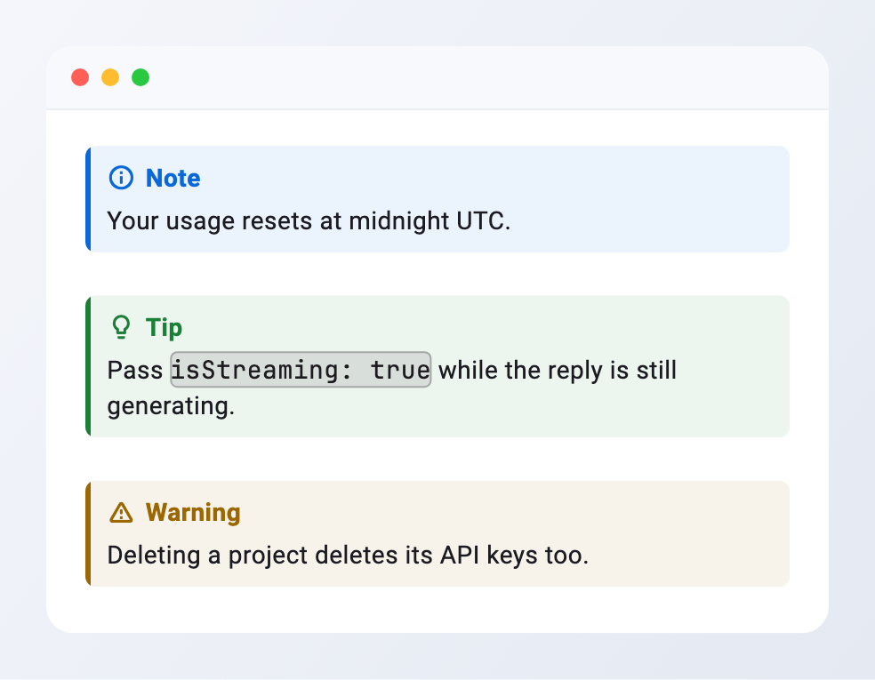

import { Code, TabItem, Tabs } from '@astrojs/starlight/components'
import example from '../../tool/screenshots/components/alert.md?raw'
import Api from './api/_alert.mdx'

<Tabs>
<TabItem label="Preview">

</TabItem>
<TabItem label="Markdown">
<Code code={example} lang="markdown" />
</TabItem>
</Tabs>

## Syntax

A quote whose first line is one of the five markers, alone on its line:

```markdown
> [!NOTE]
> [!TIP]
> [!IMPORTANT]
> [!WARNING]
> [!CAUTION]
```

The marker is case-insensitive. Anything else — `[!FOO]`, or text after the
marker — stays an ordinary quote.

## Styling

A quote whose first line is `[!NOTE]`, `[!TIP]`, `[!IMPORTANT]`, `[!WARNING]`
or `[!CAUTION]` is drawn as an alert: an icon and title in an accent colour
over the body, beside a bar in the same colour, on a faint tint of that colour
with rounded corners. The marker is
case-insensitive and must be alone on its line; anything else — `[!FOO]`, or
text after the marker — stays an ordinary quote.

```markdown
> [!WARNING]
> Back up your data before upgrading.
```

`color` · `backgroundColor` · `icon` · `iconSize` · `showIcon` · `title` ·
`titleStyle` · `titleGap` · `textStyle` · `barWidth` · `borderRadius` ·
`padding` · `margin` · `note` · `tip` · `important` · `warning` · `caution`

The top-level fields apply to every type. `note`, `tip`, `important`,
`warning` and `caution` take an `AlertStyle` that overrides them for that type,
field by field:

```dart
styleSheet: const GptMarkdownStyleSheet(
  alert: AlertStyle(
    barWidth: 4,
    backgroundColor: Color(0x0A000000),
    borderRadius: Radius.circular(8),
    warning: AlertStyle(
      title: 'Heads up',
      icon: Icons.bolt,
      color: Colors.deepOrange,
    ),
    tip: AlertStyle(title: '', showIcon: false), // body only
  ),
),
```

Unset, each type gets its own accent colour — a lighter one on a dark
`ColorScheme` — its own icon, and an English title ("Note", "Tip",
"Important", "Warning", "Caution"). Set `title` to translate them. An empty
`title` with `showIcon: false` hides the title row.

The background defaults to the accent colour at 8% opacity (12% on a dark
scheme), so it blends with whatever surface the alert sits on and follows a
custom `color`. `backgroundColor: Colors.transparent` turns the tint off, and
`borderRadius: Radius.zero` squares the corners.

**Replacing the widget.** `alertBuilder` receives `AlertBuildDetails`: the
`type`, the resolved `style`, the stock `title` row and the rendered `content`.
`defaultAlert()` returns the stock alert and `asBlockQuote()` the plain quote,
marker included:

```dart
GptMarkdown(
  text,
  alertBuilder: (context, details) {
    if (details.type == MarkdownAlertType.tip) {
      return details.asBlockQuote(); // no alert for tips
    }
    return Card(
      color: details.style.color!.withValues(alpha: 0.08),
      child: Padding(
        padding: const EdgeInsets.all(12),
        child: Column(
          crossAxisAlignment: CrossAxisAlignment.start,
          children: [details.title, const SizedBox(height: 4), details.content],
        ),
      ),
    );
  },
)
```

An app that sets `blockQuoteBuilder` and no `alertBuilder` keeps getting
alerts through `blockQuoteBuilder`, as ordinary quotes — the look it built for
quotes does not change. Add an `alertBuilder` to opt in.

## API reference

<Api />
