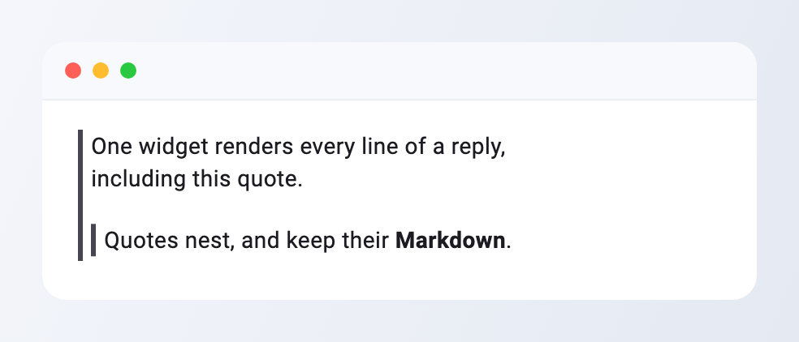

import { Code, TabItem, Tabs } from '@astrojs/starlight/components'
import example from '../../tool/screenshots/components/blockquote.md?raw'
import Api from './api/_blockquote.mdx'

<Tabs>
<TabItem label="Preview">

</TabItem>
<TabItem label="Markdown">
<Code code={example} lang="markdown" />
</TabItem>
</Tabs>

## Syntax

`>` at the start of a line; `>>` nests. Everything inside is Markdown. A quote
whose first line is `[!NOTE]` or another marker is an [alert](/docs/components/alert/)
instead.

## Styling

```dart
styleSheet: const GptMarkdownStyleSheet(
  blockQuote: BlockQuoteStyle(
    barWidth: 4,
    barColor: Color(0xFF6366F1),
    barRadius: Radius.circular(2),
    backgroundColor: Color(0x0A6366F1),
    padding: EdgeInsetsDirectional.only(start: 12, top: 8, bottom: 8),
    margin: EdgeInsets.symmetric(vertical: 8),
    textStyle: TextStyle(fontStyle: FontStyle.italic),
  ),
),
```

A background is only drawn when you ask for one — no extra widget in the tree
otherwise.

**A callout style with a builder:**

```dart
GptMarkdown(
  text,
  blockQuoteBuilder: (context, content, style) => Card(
    color: Theme.of(context).colorScheme.surfaceContainerHighest,
    child: Padding(padding: const EdgeInsets.all(12), child: content),
  ),
)
```

## API reference

<Api />
