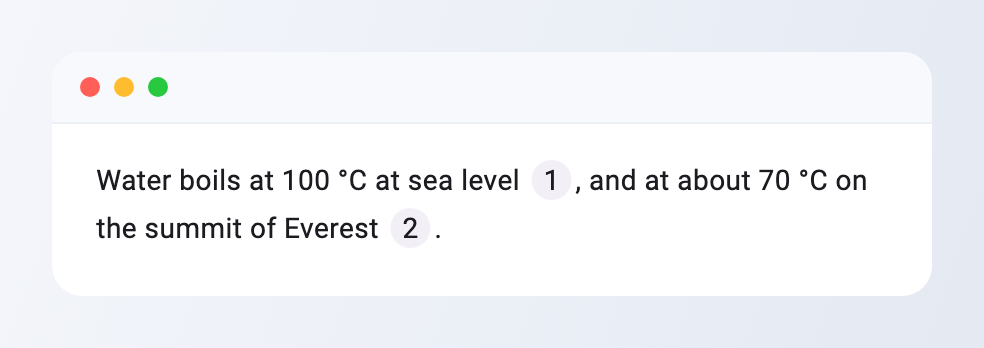

import { Code, TabItem, Tabs } from '@astrojs/starlight/components'
import example from '../../tool/screenshots/components/citation.md?raw'
import Api from './api/_citation.mdx'

<Tabs>
<TabItem label="Preview">

</TabItem>
<TabItem label="Markdown">
<Code code={example} lang="markdown" />
</TabItem>
</Tabs>

## Syntax

`[1]`, `[2]` … in the text render as chips. With a `[1]: url` line — hidden
from the output — a tap opens that URL through `onLinkTap`. Set
`onSourceTagTap` to handle every tap yourself; it wins when set.

```dart
GptMarkdown(reply, onSourceTagTap: (content) => showSource(content))
```

## Styling

The chip drawn for a `[1]` citation, common in RAG answers.

```dart
styleSheet: const GptMarkdownStyleSheet(
  sourceTag: SourceTagStyle(
    size: 18,
    backgroundColor: Color(0xFFE8DEF8),
    shape: BoxShape.rectangle,
    textStyle: TextStyle(fontSize: 11, fontWeight: FontWeight.w600),
  ),
),

GptMarkdown(text, onSourceTagTap: (content) => showSource(content))
```

## API reference

<Api />
