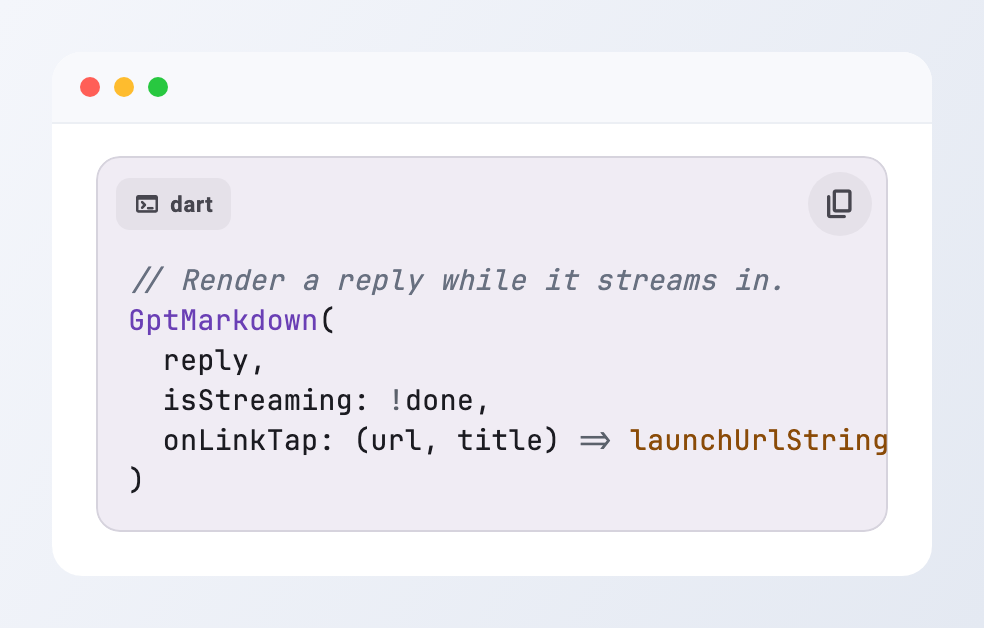

import { Code, TabItem, Tabs } from '@astrojs/starlight/components'
import example from '../../tool/screenshots/components/code-block.md?raw'
import Api from './api/_code-block.mdx'

<Tabs>
<TabItem label="Preview">

</TabItem>
<TabItem label="Markdown">
<Code code={example} lang="markdown" />
</TabItem>
</Tabs>

## Syntax

```` ``` ```` or `~~~` fences. A language tag highlights the code; an unknown
or missing tag shows it as plain monospace, and a missing tag labels the block
`Code`. The copy button calls `onCodeCopy` after a successful copy.

```dart
GptMarkdown(reply, onCodeCopy: (code) => analytics.log('code_copied'))
```

## Styling

```dart
styleSheet: const GptMarkdownStyleSheet(
  codeBlock: CodeBlockStyle(
    backgroundColor: Color(0xFF1E1E1E),
    textColor: Color(0xFFD4D4D4),
    borderRadius: Radius.circular(12),
    padding: EdgeInsets.all(20),
    fontFamily: 'GeistMono',
    showLanguageLabel: true,
    showCopyButton: true,
  ),
),
```

**Localise the copy-button tooltip** without replacing the block:

```dart
codeBlock: CodeBlockStyle(
  copyLabel: AppLocalizations.of(context).copyCode,
  copiedLabel: AppLocalizations.of(context).copied,
),
```

**React to a copy:**

```dart
GptMarkdown(text, onCodeCopy: (code) => analytics.log('code_copied'))
```

### Syntax highlighting

Fenced blocks are highlighted automatically when the opening fence names a
recognized language:

````markdown
```python
def greet(name: str) -> str:
    return f"Hello, {name}!"
```
````

The built-in highlighter registers 57 language grammars and follows the
active light or dark brightness. Common fence aliases include `js`, `ts`,
`py`, `python3`, `c++`, `sh` and `yml`. Unknown tags fall back to plain
monospace code, and an omitted tag displays `Code` in the header.

While a fence is still open the block is highlighted again on every source
update. `highlightWhileStreaming: false` holds plain monospace until the closing
fence arrives and highlights once, which is worth setting when replies stream
long blocks. It defaults to true because that is what the package did before the
field existed.

No syntax-theme field is exposed. `CodeBlockStyle` controls the panel, font and
base/fallback text appearance; the built-in token palette is automatic. When
an application needs its own tokenizer or token colors, replace the complete
block with the existing `codeBuilder`.

The built-in copy action keeps the code unchanged, briefly changes its icon to
a check, ignores repeated taps during that state, and invokes `onCodeCopy`
after the clipboard write succeeds.

:::caution
Code lines do not wrap. On a phone at a raised text scale a long line
overflows horizontally. The block scrolls sideways, but if you need it to
wrap, replace it:
:::

```dart
GptMarkdown(
  text,
  codeBuilder: (context, name, code, closed) => Container(
    width: double.infinity,
    padding: const EdgeInsets.all(12),
    color: Theme.of(context).colorScheme.surfaceContainerHighest,
    child: SelectableText(code, style: const TextStyle(fontFamily: 'monospace')),
  ),
)
```

`closed` is false while a fence is still being streamed — useful for showing a
"generating" state.

## API reference

<Api />
