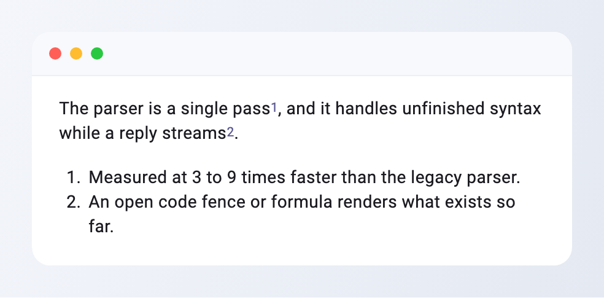

import { Code, TabItem, Tabs } from '@astrojs/starlight/components'
import example from '../../tool/screenshots/components/footnotes.md?raw'

<Tabs>
<TabItem label="Preview">

</TabItem>
<TabItem label="Markdown">
<Code code={example} lang="markdown" />
</TabItem>
</Tabs>

## Syntax

`text[^name]` references a note; `[^name]: the note` defines it. The name can
be anything — the reference shows a number, not the name.

- **Numbered by first reference**, as on GitHub: the first note the text cites
  is 1, whatever order the definitions are written in. A repeated reference
  keeps its first number.
- **Listed where the definitions are written**, as a numbered list. Definitions
  separated by blank lines still form one list.
- **A definition nothing refers to is not shown.** A reference inside code does
  not count, and one inside another footnote does.
- A definition continues on the lines after it; indent a following paragraph to
  keep it in the same note.

## Styling

There is no footnote style object or builder of its own.

- A **reference** is its number at three-quarters of the surrounding text size,
  raised to the top of the line, in `ColorScheme.primary`. It is not tappable.
- The **notes** are drawn by the same code as an ordered list, so
  [`ListStyle`](/docs/components/lists/#styling) and
  [`orderedListBuilder`](/docs/components/lists/#api-reference) apply to them.
