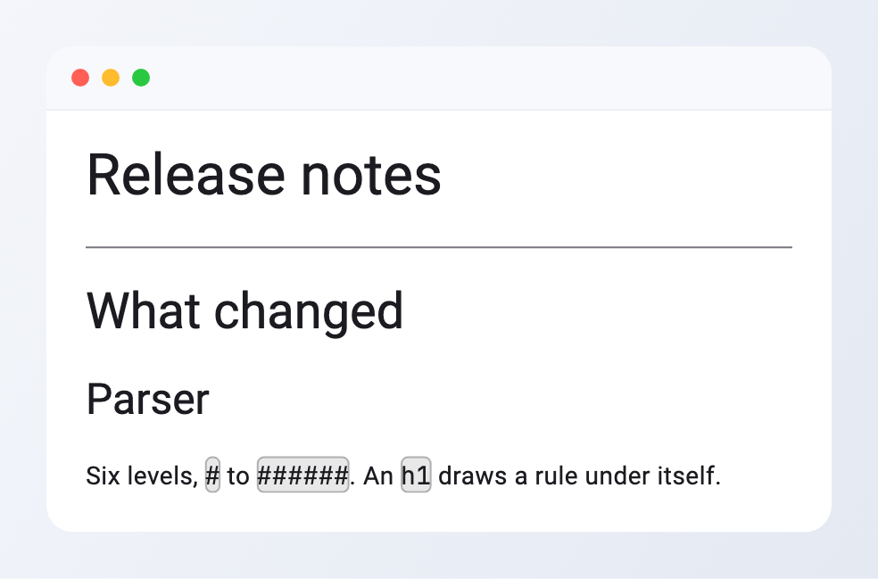

import { Code, TabItem, Tabs } from '@astrojs/starlight/components'
import example from '../../tool/screenshots/components/heading.md?raw'
import Api from './api/_heading.mdx'

<Tabs>
<TabItem label="Preview">

</TabItem>
<TabItem label="Markdown">
<Code code={example} lang="markdown" />
</TabItem>
</Tabs>

## Syntax

`#` to `######` start a heading; closing `#`s are optional. A line underlined
with `===` or `---` is a heading too (setext), which is why a `---` directly
under text makes a heading rather than a rule — leave a blank line before a
horizontal rule.

Sizes come from `GptMarkdownThemeData`'s `h1` to `h6`, which default to the
Material text theme; `HeadingStyle` changes everything else.

## Styling

```dart
GptMarkdown(
  text,
  styleSheet: const GptMarkdownStyleSheet(
    heading: HeadingStyle(
      textStyle: TextStyle(letterSpacing: -0.5),
      padding: EdgeInsets.only(top: 8, bottom: 4),
      showDivider: false,
    ),
  ),
)
```

`textStyle` is merged **over** the per-level style, so you change one property
without restating the size. Per-level sizes still come from the theme:

```dart
GptMarkdownThemeData(
  brightness: Brightness.light,
  h1: Theme.of(context).textTheme.headlineMedium,
  h2: Theme.of(context).textTheme.titleLarge,
)
```

`showDivider: false` removes the rule an `h1` draws by default. Leave it null
to keep following `autoAddDividerLineAfterH1`.

**Restructure with a builder** — for example, anchors on every heading:

```dart
GptMarkdown(
  text,
  headingBuilder: (context, level, content, style) => Row(
    crossAxisAlignment: CrossAxisAlignment.baseline,
    textBaseline: TextBaseline.alphabetic,
    children: [
      Flexible(child: content),
      IconButton(icon: const Icon(Icons.link), onPressed: () {}),
    ],
  ),
)
```

`level` is 1–6, so one builder handles all six.

## API reference

<Api />
