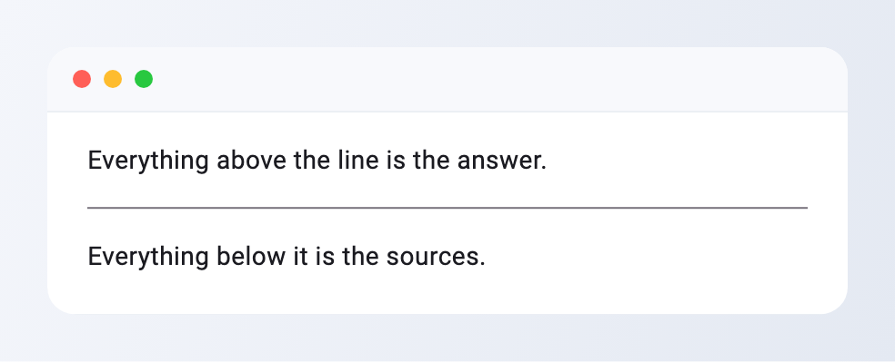

import { Code, TabItem, Tabs } from '@astrojs/starlight/components'
import example from '../../tool/screenshots/components/horizontal-rule.md?raw'
import Api from './api/_horizontal-rule.mdx'

<Tabs>
<TabItem label="Preview">

</TabItem>
<TabItem label="Markdown">
<Code code={example} lang="markdown" />
</TabItem>
</Tabs>

## Syntax

`---` on a line of its own, with a blank line before it. Directly under a line
of text, `---` makes that line a [heading](/docs/components/heading/) instead.
`<hr>` on its own line works too.

## Styling

```dart
styleSheet: const GptMarkdownStyleSheet(
  hr: HrStyle(
    thickness: 2,
    color: Color(0x1F000000),
    padding: EdgeInsets.symmetric(vertical: 16),
  ),
),
```

**A dotted rule:**

```dart
GptMarkdown(
  text,
  hrBuilder: (context, style) => const Padding(
    padding: EdgeInsets.symmetric(vertical: 12),
    child: DottedLine(),
  ),
)
```

## API reference

<Api />
