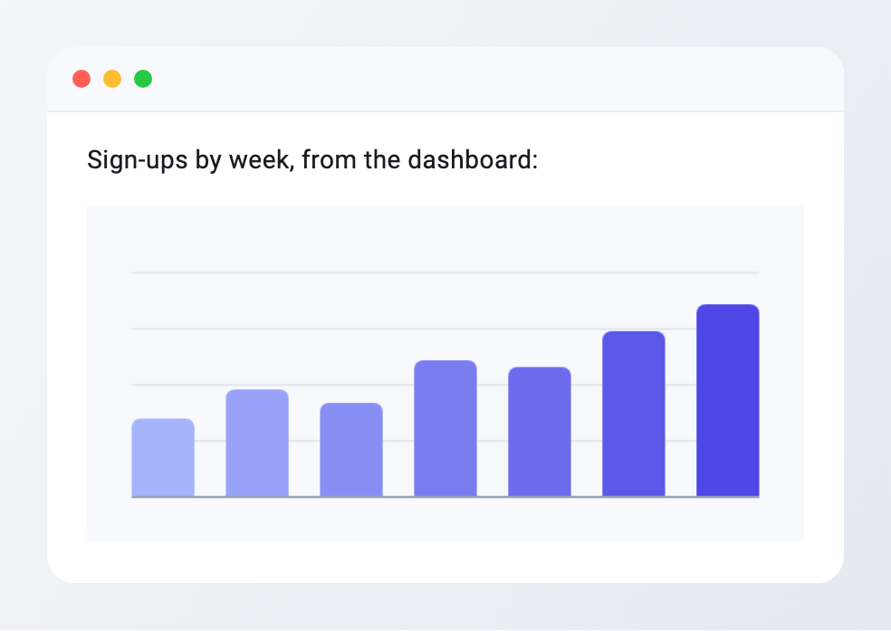

import { Code, TabItem, Tabs } from '@astrojs/starlight/components'
import example from '../../tool/screenshots/components/image.md?raw'
import Api from './api/_image.mdx'

<Tabs>
<TabItem label="Preview">

</TabItem>
<TabItem label="Markdown">
<Code code={example} lang="markdown" />
</TabItem>
</Tabs>

## Syntax

``, `![alt][ref]`, ``, and an image as a
link's label, `[](url)`. PNG, JPEG, GIF, WebP and SVG load from
`http(s)` and from `data:` URLs.

A tap calls `onImageTap` with the URL — except an image that is a link's
label, which follows the link through `onLinkTap`.

The preview's chart is served to the widget under the URL in the Markdown, so
it shows exactly what the default image renders.

## Styling

```dart
styleSheet: const GptMarkdownStyleSheet(
  image: ImageStyle(
    borderRadius: Radius.circular(8),
    padding: EdgeInsets.symmetric(vertical: 8),
    maxHeight: 320,
  ),
),
```

**Cached network images**, with a placeholder and error state:

```dart
GptMarkdown(
  text,
  imageBuilder: (context, url, width, height) => CachedNetworkImage(
    imageUrl: url,
    width: width,
    height: height,
    placeholder: (context, _) => const SizedBox(
      height: 120,
      child: Center(child: CircularProgressIndicator()),
    ),
    errorWidget: (context, _, __) => const Icon(Icons.broken_image),
  ),
  onImageTap: (url) => openLightbox(url),
)
```

`width` and `height` come from the alt text when written as `WxH`.

**Inline images.** A `data:` URL works wherever a network URL does:

```markdown

```

The default image widget decodes it — base64 or percent-encoded — and keeps
the decoded bytes, so a streaming reply that rebuilds constantly does not
decode or flicker again. Data that does not decode, or is not an image, shows
the broken-image icon. A large image is decoded on the UI thread the first time
it appears, which is fine at chart and screenshot sizes.

**SVG.** An SVG renders like any other image: a `.svg` URL or a
`data:image/svg+xml` URL directly, and an image whose URL says nothing — a
README badge such as `https://img.shields.io/pub/v/gpt_markdown` — when it
arrives and turns out not to be a bitmap. Each SVG is downloaded once and kept,
so a streaming reply does not fetch it again. A download that fails, or a
response that is not an SVG, shows the broken-image icon. Two gaps in
`flutter_svg` are worked around first, both hit by every shields.io badge: text
inside a uniformly scaled group is rewritten to its real size (it would be ten
times too large), and an SVG embedded in an `<image>` — a badge's logo — is
inlined (it would be dropped; only bitmaps are drawn there). Unsized, an SVG keeps
its own proportions (`BoxFit.contain`); `ImageStyle.fit` overrides that.

An `imageBuilder` receives the `data:` URL as written. `CachedNetworkImage`
and other network loaders cannot open one, so a builder that uses them should
hand `data:` URLs to `Image.memory(UriData.parse(url).contentAsBytes())`.

## API reference

<Api />
