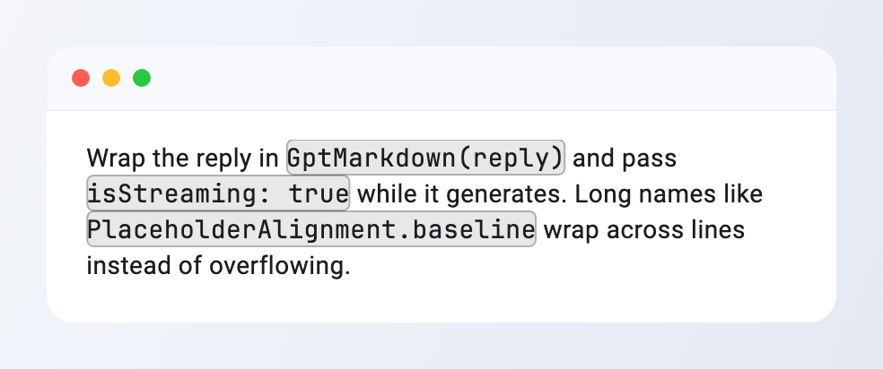

import { Code, TabItem, Tabs } from '@astrojs/starlight/components'
import example from '../../tool/screenshots/components/inline-code.md?raw'
import Api from './api/_inline-code.mdx'

<Tabs>
<TabItem label="Preview">

</TabItem>
<TabItem label="Markdown">
<Code code={example} lang="markdown" />
</TabItem>
</Tabs>

## Syntax

`` `code` ``, or ``` `` with ` inside `` ``` when the code contains a backtick.
The content is not Markdown. Inline code is a span, not a widget, so a long
identifier wraps across lines with the paragraph and joins text selection.

Its size is a factor of the surrounding `style`, so it follows the body text.

## Styling

**Your app's mono font:**

```dart
styleSheet: const GptMarkdownStyleSheet(
  inlineCode: InlineCodeStyle(fontFamily: 'GeistMono'),
),
```

**A GitHub-ish chip:**

```dart
inlineCode: InlineCodeStyle(
  backgroundColor: const Color(0x14656D76),
  borderColor: Colors.transparent,
  borderRadius: const Radius.circular(6),
  padding: const EdgeInsets.symmetric(horizontal: 5, vertical: 2),
),
```

**No chip at all, just monospace:**

```dart
inlineCode: InlineCodeStyle(
  backgroundColor: Colors.transparent,
  borderWidth: 0,
  padding: EdgeInsets.zero,
),
```

:::tip
`fontSizeFactor` is a factor, not a size, so inline code scales with whatever
it sits in — a heading, a table cell, body text. Setting an absolute size
breaks that.
:::

Inline code is a real `TextSpan` with the chip painted underneath, once per
line fragment. It wraps across lines, stays selectable, sits on the baseline,
and works inside a link label — none of which a widget-based chip can do.

**Per-code styling** needs the builder:

```dart
GptMarkdown(
  text,
  inlineCodeBuilder: (context, code, style, codeStyle) => CodeTextSpan(
    text: code,
    style: style,
    codeStyle: codeStyle.copyWith(
      backgroundColor: code.startsWith('TODO') ? Colors.amber : null,
    ),
  ),
)
```

Returning `CodeTextSpan` keeps the painted chip. Return a plain `TextSpan` to
drop it.

## API reference

<Api />
