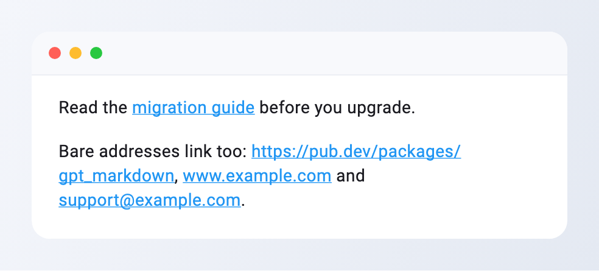

import { Code, TabItem, Tabs } from '@astrojs/starlight/components'
import example from '../../tool/screenshots/components/link.md?raw'
import Api from './api/_link.mdx'

<Tabs>
<TabItem label="Preview">

</TabItem>
<TabItem label="Markdown">
<Code code={example} lang="markdown" />
</TabItem>
</Tabs>

## Syntax

`[label](url "title")`, `[label](<url with spaces>)`, and reference links
`[label][ref]` with a `[ref]: url` line. Bare URLs, `www.` hosts, email
addresses and `<https://…>` are linked automatically —
[inline syntax](/docs/inline-syntax/#autolinks) covers schemes and turning it off.

Links do nothing on their own: the package does not depend on a URL launcher,
so opening one is your decision.

```dart
GptMarkdown(
  reply,
  onLinkTap: (url, title) => launchUrlString(url),
)
```

:::tip
Model output can contain any URL. Validate it before launching —
[Getting started](/docs/getting-started/#handling-taps) has an example.
:::

## Styling

```dart
styleSheet: const GptMarkdownStyleSheet(
  link: LinkStyle(
    color: Color(0xFF0B57D0),
    hoverColor: Color(0xFF0842A0),
    decoration: TextDecoration.none,
    fontWeight: FontWeight.w500,
  ),
),
```

:::note[Important]
Links do nothing on tap unless you handle them. The package deliberately does
not depend on a URL launcher.
:::

```dart
GptMarkdown(text, onLinkTap: (url, title) => launchUrlString(url))
```

`title` is the label text, which is useful for confirmation dialogs:

```dart
onLinkTap: (url, title) async {
  final ok = await confirm('Open "$title"?\n$url');
  if (ok) await launchUrlString(url);
},
```

## API reference

<Api />
