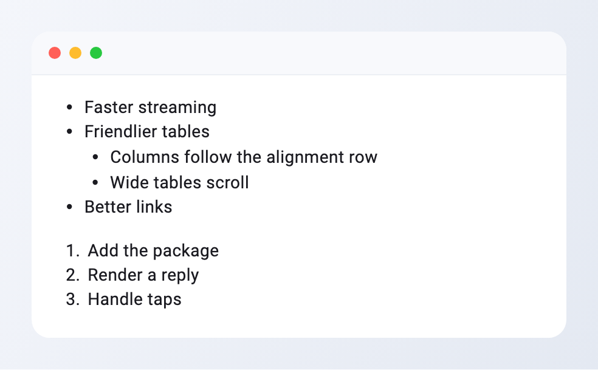

import { Code, TabItem, Tabs } from '@astrojs/starlight/components'
import example from '../../tool/screenshots/components/lists.md?raw'
import Api from './api/_lists.mdx'

<Tabs>
<TabItem label="Preview">

</TabItem>
<TabItem label="Markdown">
<Code code={example} lang="markdown" />
</TabItem>
</Tabs>

## Syntax

`-` (or `*`, `+`) for bullets, `1.` for numbers; indent to nest. The numbers
come from the text, so a list can start at any number — but only a list
starting at `1.` can begin inside a paragraph, so prose that wraps onto a line
starting `14. ` stays prose. A line directly after an item continues it; leave
a blank line to end the list.

## Styling

```dart
styleSheet: const GptMarkdownStyleSheet(
  list: ListStyle(
    bulletSize: 5,
    bulletColor: Colors.indigo,
    bulletShape: BoxShape.rectangle,
    indent: 12,
    gapAfterMarker: 12,
    markerTextStyle: TextStyle(fontWeight: FontWeight.w600),
  ),
),
```

`markerTextStyle` is the `1.` on an ordered list. `bulletSize` and
`bulletColor` default to values derived from the surrounding text, so they
track your font size unless you pin them.

:::note
Bullets and numbers keep separate spacing defaults — 7/10 for bullets, 6/6
for numbers. Setting `indent` or `gapAfterMarker` applies to both.
:::

## API reference

<Api />
