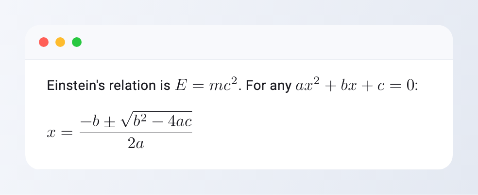

import { Code, TabItem, Tabs } from '@astrojs/starlight/components'
import example from '../../tool/screenshots/components/math.md?raw'
import Api from './api/_math.mdx'

<Tabs>
<TabItem label="Preview">

</TabItem>
<TabItem label="Markdown">
<Code code={example} lang="markdown" />
</TabItem>
</Tabs>

## Syntax

`\( … \)` for an inline formula and `\[ … \]` for a block one — or `$…$` and
`$$…$$` with `useDollarSignsForLatex`, below.

## Usage

Maths renders with no configuration.
[`val_latex_flutter`](https://pub.dev/packages/val_latex_flutter) is a
dependency of the package, and the built-in renderer uses it — falling back to
the raw TeX as text when a formula will not parse. A formula that is still
streaming in (`\frac{a`) renders what exists so far instead of failing.


**Tapping a formula.** `onLatexTap` is called with the formula and the part of
it under the finger:

```dart
GptMarkdown(
  reply,
  onLatexTap: (tap) => showFormula(context, tap.source, part: tap.tappedTex),
)
```

**Your own renderer.** `inlineLatexBuilder` builds an inline formula
(`\( … \)`) as a span, and `blockLatexBuilder` builds a block formula
(`\[ … \]`) as a widget. Each is handed one details object: the formula
(`tex`, after `latexWorkaround`; `source`, as written), the resolved `style`,
an `onTap` already bound to `onLatexTap`, and the stock formula
(`defaultSpan()` / `defaultWidget()`) to keep or wrap.

```dart
import 'package:val_latex_flutter/val_latex_flutter.dart' show Math, MathSpan;

GptMarkdown(
  reply,
  // A span: sits on the baseline and joins text selection.
  inlineLatexBuilder: (latex) => MathSpan(
    latex.tex,
    style: latex.style,
    onTap: (tap) => explain(tap.tex),
  ),
  // The stock formula, with a tooltip.
  blockLatexBuilder: (latex) =>
      Tooltip(message: latex.source, child: latex.defaultWidget()),
)
```

`latexBuilder`, the single widget builder both replace, is deprecated and
still works where neither is set.

:::caution
The built-in renderer does not wrap. A wide block formula overflows on a
phone.
:::

A display formula can wrap to the width, and scroll what cannot break:

```dart
blockLatexBuilder: (latex) => Math.tex(
  latex.tex,
  displayMode: true,
  textStyle: latex.style,
  onError: (context, result) => Text(latex.tex, style: latex.style),
),
```

Wrapping needs the available width, so a wrapping formula has no intrinsic
size: inside `IntrinsicWidth` — a common way to shrink-wrap a chat bubble — it
throws. That is why the built-in renderer does not wrap.

Or let the package do it:

```dart
styleSheet: const GptMarkdownStyleSheet(
  latex: LatexStyle(scrollBlockHorizontally: true),
),
```

**Dollar-sign maths.** If your model emits `$…$` and `$$…$$`:

```dart
GptMarkdown(reply, useDollarSignsForLatex: true)
```

:::note
Two prices on one line (`$5 and $10`) stay text, but a single price before
a formula pairs with it: in `costs $5, so $x^2$`, `5, so ` becomes maths.
Escape the price (`\$5`), or use `\(…\)` for the formula.
:::

## Styling

```dart
styleSheet: const GptMarkdownStyleSheet(
  latex: LatexStyle(
    scrollBlockHorizontally: true,
    padding: EdgeInsets.symmetric(vertical: 8),
    backgroundColor: Color(0x08000000),
    borderRadius: Radius.circular(6),
  ),
),
```

:::caution
Rendered maths cannot wrap. Without `scrollBlockHorizontally: true`, a wide
formula overflows on a phone. This is the single most common LaTeX
complaint.
:::

The renderer itself is built in. `inlineLatexBuilder` and `blockLatexBuilder`
replace it, and `onLatexTap` handles taps — see
[LaTeX math](/docs/components/math/).

## API reference

<Api />
