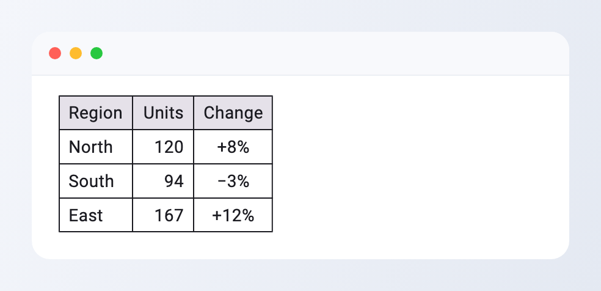

import { Code, TabItem, Tabs } from '@astrojs/starlight/components'
import example from '../../tool/screenshots/components/table.md?raw'
import Api from './api/_table.mdx'

<Tabs>
<TabItem label="Preview">

</TabItem>
<TabItem label="Markdown">
<Code code={example} lang="markdown" />
</TabItem>
</Tabs>

## Syntax

GitHub-style pipes, with the alignment row deciding each column:
`:---` left, `---:` right, `:---:` centre. Cells hold inline Markdown — bold,
code, links, maths. HTML `<table>`s with `colspan` and `rowspan` work too; see
[HTML](/docs/commonmark/#html).

## Styling

```dart
styleSheet: const GptMarkdownStyleSheet(
  table: TableStyle(
    borderColor: Color(0x1F000000),
    borderWidth: 1,
    borderRadius: Radius.circular(8),
    cellPadding: EdgeInsets.symmetric(horizontal: 12, vertical: 8),
    headerBackground: Color(0x0A000000),
    headerTextStyle: TextStyle(fontWeight: FontWeight.w600),
  ),
),
```

`columnWidth` sets one width policy for every column. Left unset, a column is
sized to its content, which lays every cell out twice — once to measure, once
for real. `columnWidth: FixedColumnWidth(120)` skips that measurement, which is
the escape hatch for a large or streaming table.

A flex policy is not, with the default `overflow`. Tables scroll horizontally
when they exceed the available width, so the table is laid out against an
unbounded width and a flex column has no finite width to take a share of:
`FlexColumnWidth()` collapses the table to zero width and wraps every cell to
one character a line.

`overflow` decides what a table wider than the screen does:

- `TableOverflow.scroll` (the default) keeps columns at their content width and
  scrolls the table sideways.
- `TableOverflow.wrap` fits the table to the available width and wraps the text
  in its cells. Columns shrink toward their longest word, so short columns stay
  whole; with more columns than the words allow, words break rather than the
  table running off screen. The table is laid out against a bounded width here,
  so a flex `columnWidth` works.

```dart
styleSheet: const GptMarkdownStyleSheet(
  table: TableStyle(overflow: TableOverflow.wrap),
),
```

## API reference

<Api />
