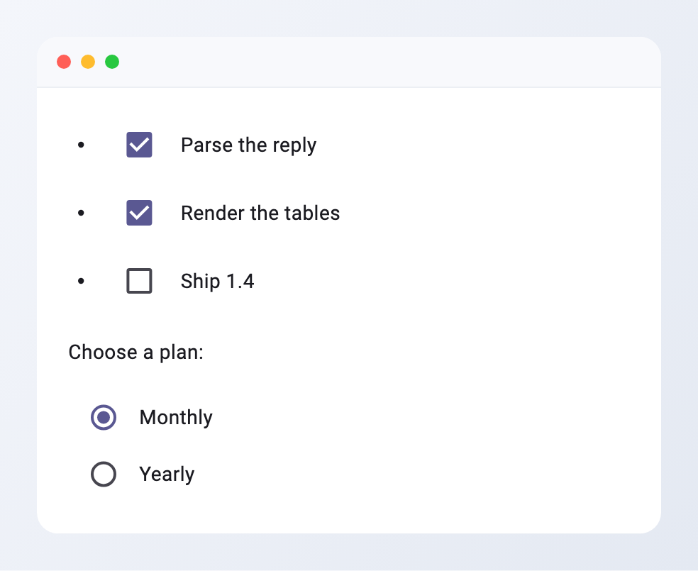

import { Code, TabItem, Tabs } from '@astrojs/starlight/components'
import example from '../../tool/screenshots/components/task-list.md?raw'
import Api from './api/_task-list.mdx'

<Tabs>
<TabItem label="Preview">

</TabItem>
<TabItem label="Markdown">
<Code code={example} lang="markdown" />
</TabItem>
</Tabs>

## Syntax

`- [x]` and `- [ ]` make a task list; `(x)` and `( )` make
radio options. Both are read-only unless `CheckboxStyle(interactive: true)`;
then a tap calls `onCheckboxChanged`.

## Styling

Applies to both `- [x]` task lists and `(x)` radio options.

```dart
styleSheet: const GptMarkdownStyleSheet(
  checkbox: CheckboxStyle(
    size: 18,
    checkedColor: Colors.green,
    borderRadius: Radius.circular(4),
    gapAfterBox: 8,
  ),
),
```

:::caution
Checkboxes are **read-only by default**. A Markdown checkbox renders the
source text — ticking it does not change the text, so the change would be
lost on the next rebuild.
:::

To make them interactive you must opt in *and* persist the result yourself:

```dart
GptMarkdown(
  markdown,
  styleSheet: const GptMarkdownStyleSheet(
    checkbox: CheckboxStyle(interactive: true),
  ),
  onCheckboxChanged: (value) {
    // Rewrite the source, or the tick reverts on the next build.
    setState(() => markdown = toggleFirstUnchecked(markdown));
  },
)
```

## API reference

<Api />
