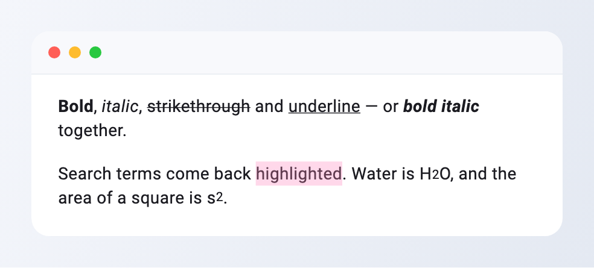

import { Code, TabItem, Tabs } from '@astrojs/starlight/components'
import example from '../../tool/screenshots/components/text-formatting.md?raw'
import Api from './api/_text-formatting.mdx'

<Tabs>
<TabItem label="Preview">

</TabItem>
<TabItem label="Markdown">
<Code code={example} lang="markdown" />
</TabItem>
</Tabs>

## Syntax

| Markdown | HTML | Renders |
|---|---|---|
| `**bold**`, `__bold__` | `<b>`, `<strong>` | bold |
| `*italic*`, `_italic_` | `<i>`, `<em>` | italic |
| `~~strike~~` | `<s>`, `<del>` | strikethrough |
| | `<u>`, `<ins>` | underline |
| | `<mark>` | highlighted (`HighlightStyle`) |
| | ``, `` | subscript, superscript (`ScriptStyle`) |

An underscore inside a word is never emphasis, so `snake_case_name` stays as
written; and `*` or `_` followed by a space opens nothing, so `2 * 3 * 4` is
arithmetic. See [Markdown syntax](/docs/syntax/#the-rules-that-decide-what-stays-text)
for the rest of the rules.

Bold, italic, strikethrough and underline follow the surrounding text style and
have no style object of their own.

## API reference

<Api />
