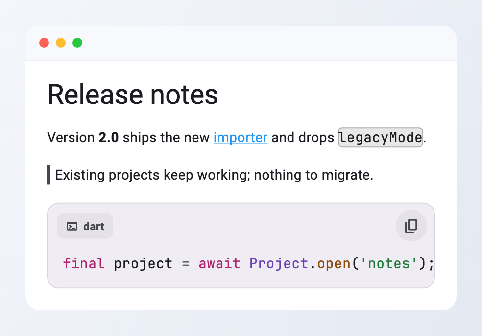
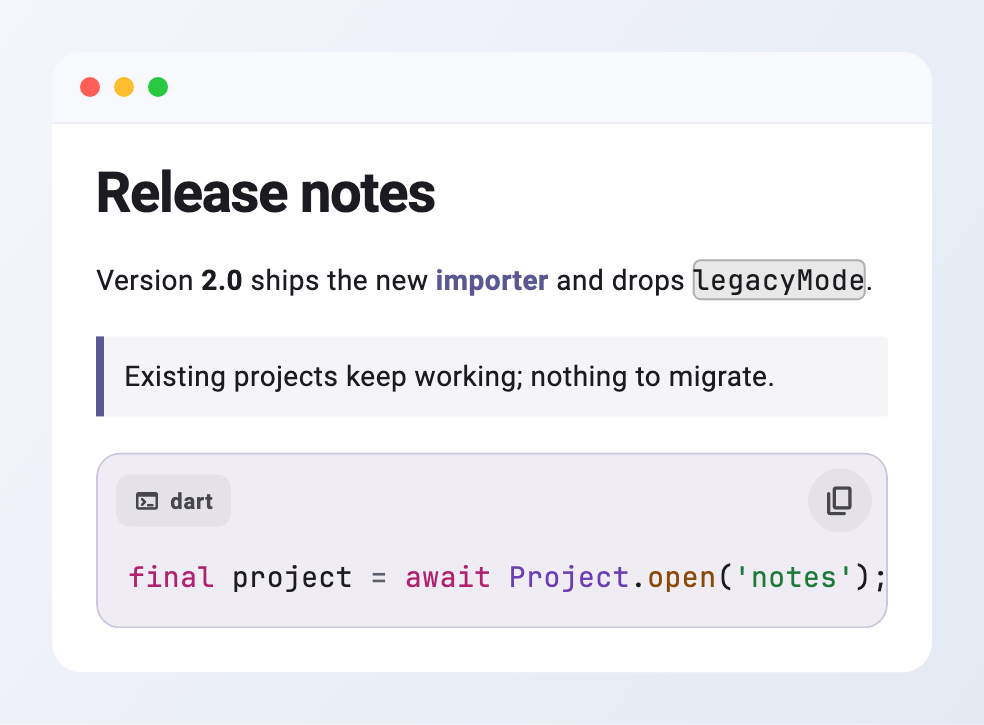

Two ways to change what you see, and they never overlap:

| | Use it for | Example |
|---|---|---|
| **Style object** | Appearance — colours, sizes, padding, fonts | `BlockQuoteStyle(barWidth: 4)` |
| **Builder** | Structure — replace the widget entirely | `blockQuoteBuilder: …` |

Every component supports both.

:::tip
If you are reaching for a builder to change a colour, stop — there is a style
field for it. Builders lose the default structure, and with it every future
improvement to that component.
:::

## A first example

Four style fields, nothing else changed:

```dart
final colors = Theme.of(context).colorScheme;

GptMarkdown(
  reply,
  styleSheet: GptMarkdownStyleSheet(
    heading: const HeadingStyle(
      textStyle: TextStyle(fontWeight: FontWeight.w700, letterSpacing: -0.6),
    ),
    link: LinkStyle(
      color: colors.primary,
      decoration: TextDecoration.none,
      fontWeight: FontWeight.w600,
    ),
    blockQuote: BlockQuoteStyle(
      barWidth: 4,
      barColor: colors.primary,
      barRadius: const Radius.circular(2),
      backgroundColor: colors.primary.withValues(alpha: 0.06),
      padding: const EdgeInsets.fromLTRB(14, 10, 14, 10),
    ),
    codeBlock: CodeBlockStyle(
      borderRadius: const Radius.circular(12),
      borderColor: colors.primary.withValues(alpha: 0.25),
    ),
  ),
)
```

<div class="uv-shots">




</div>

Left, the defaults; right, the style sheet above. Every other field still
comes from the theme, so nothing else moves.

## Where a style goes

The same object is accepted in two places.

**One widget:**

```dart
GptMarkdown(
  text,
  styleSheet: const GptMarkdownStyleSheet(
    blockQuote: BlockQuoteStyle(barWidth: 4),
  ),
)
```

**The whole app:**

```dart
MaterialApp(
  theme: ThemeData(
    extensions: [
      GptMarkdownThemeData(
        brightness: Brightness.light,
        styleSheet: const GptMarkdownStyleSheet(
          blockQuote: BlockQuoteStyle(barColor: Colors.indigo),
          codeBlock: CodeBlockStyle(borderRadius: Radius.circular(12)),
        ),
      ),
      // Dark needs its own — the extension is per ThemeData.
    ],
  ),
)
```

### The merge is per field

With both of the above in force, the quote gets `barWidth: 4` from the widget
**and** `barColor: Colors.indigo` from the theme.

```
widget field  →  theme field  →  package default
```

Overriding one value never discards the rest.

:::note
Every field is optional, and anything left unset resolves to the value the
package used before it was configurable. **Adding a style sheet never changes
how existing content looks.** A golden suite covering eight constructs in
light and dark enforces that on every commit.
:::

## Spacing between blocks

`blockSpacing` sets the vertical gap between blocks — paragraphs, headings,
lists, code, tables, quotes — in logical pixels:

```dart
styleSheet: const GptMarkdownStyleSheet(blockSpacing: 8),
```

Unset, the gap is one empty line: 1.15 × the font size, 16 pixels at the
default 14. It grows with the text scale either way, so a reader who enlarges
text keeps the same proportions. Extra blank lines in the source never widen
it — two, three or ten in a row give one gap — and `0` removes it.

A block's own margin or padding is added on top, so a quote with
`BlockQuoteStyle(margin: ...)` sits that much further away.

## Each component's styles

Every component has its own page under **Components** — its style object's
fields with their defaults, its builder's exact signature and its callbacks,
generated from the source. Start at the [components overview](/docs/components/).

## Builders

Where a builder is handed a style-sheet object, it is the **fully resolved**
one, so the builder never has to guess a default or restate a theme colour.
Check the signature first, though: `codeBuilder`, `imageBuilder`,
`tableBuilder`, `orderedListBuilder` and `unOrderedListBuilder` are handed no
style-sheet object — they replace the component outright, and `CodeBlockStyle`,
`ImageStyle`, `TableStyle` and `ListStyle` never reach them. The `TextStyle`
`tableBuilder` does receive is the ambient body style, empty when the widget
sets none.

Three of the deprecated builders carry an unresolved style as well, kept that
way because the builders written against them expect it: `sourceTagBuilder` is
handed an empty `TextStyle` whenever `SourceTagStyle.textStyle` is unset,
`linkBuilder` the ambient body style rather than the resolved link style its
replacement is given, and `highlightBuilder` the ambient body style — the
resolved code style reaches it only where the surrounding style is null.

| Builder | Signature |
|---|---|
| `headingBuilder` | `(context, int level, Widget content, HeadingStyle style)` |
| `blockQuoteBuilder` | `(context, Widget content, BlockQuoteStyle style)` |
| `alertBuilder` | `(context, AlertBuildDetails details)` |
| `checkboxBuilder` | `(context, bool checked, Widget content, CheckboxStyle style)` |
| `radioOptionBuilder` | `(context, bool selected, Widget content, CheckboxStyle style)` |
| `hrBuilder` | `(context, HrStyle style)` |
| `codeBuilder` | `(context, String name, String code, bool closed)` |
| `tableBuilder` | `(context, rows, TextStyle style, GptMarkdownConfig config)` |
| `imageBuilder` | `(context, String url, double? width, double? height)` |
| `inlineLatexBuilder` | `(InlineLatexBuildDetails details)` → `InlineSpan` |
| `blockLatexBuilder` | `(BlockLatexBuildDetails details)` → `Widget` |
| `latexBuilder` | *Deprecated.* `(context, String tex, TextStyle style, bool inline)` |
| `inlineLinkBuilder` | `(LinkBuildDetails details)` → `InlineSpan` |
| `linkBuilder` | *Deprecated.* `(context, InlineSpan label, String url, TextStyle style)` |
| `inlineCodeBuilder` | `(context, String code, TextStyle style, InlineCodeStyle codeStyle)` |
| `highlightBuilder` | *Deprecated.* `(context, String text, TextStyle style)` |
| `inlineSourceTagBuilder` | `(SourceTagBuildDetails details)` → `InlineSpan` |
| `sourceTagBuilder` | *Deprecated.* `(context, String content, TextStyle style)` |
| `orderedListBuilder` | `(context, String no, Widget child, GptMarkdownConfig config)` |
| `unOrderedListBuilder` | `(context, Widget child, GptMarkdownConfig config)` |

Reuse the style you are given rather than hard-coding:

```dart
blockQuoteBuilder: (context, content, style) => DecoratedBox(
  decoration: BoxDecoration(
    border: BorderDirectional(
      start: BorderSide(
        // Follows the theme, because the resolved style is passed in.
        color: style.barColor ?? Colors.grey,
        width: style.barWidth ?? 3,
      ),
    ),
  ),
  child: content,
),
```

### The inline builders return a span, not a widget

`inlineCodeBuilder`, `inlineLinkBuilder` and `inlineSourceTagBuilder` all
return an `InlineSpan`. Deliberate. A `Widget` has to be wrapped in a
`WidgetSpan`, which cannot wrap across lines, is skipped by text selection,
sits off the baseline, and is one opaque character to the streaming reveal.

Migrating a `linkBuilder`, term by term:

| old positional argument | new |
|---|---|
| `context` | `details.context` |
| `label` (one span) | `details.labelSpans` — already parsed, already styled |
| `url` | `details.url` |
| `style` | `details.style` — now the *resolved* link style |
| — | `details.linkStyle`, the resolved `LinkStyle` |
| — | `details.isAutolink` |
| — | `details.onTap`, which calls `onLinkTap` for you |
| — | `details.hoverStyle` |
| — | `details.config` |

Because a builder receives one details object rather than positional
arguments, a later release adds a field here instead of a parameter — so
nothing you write today stops compiling.

```dart
// keep the stock link, change one thing
inlineLinkBuilder: (link) =>
    link.defaultSpan(style: link.style.copyWith(fontWeight: FontWeight.bold)),
```

> A `GestureRecognizer` fires only on a `TextSpan` that carries its own `text`,
> never on one that only has `children`. A parsed link label is the second
> kind, so `TextSpan(children: link.labelSpans, recognizer: tap)` renders
> correctly and is silently never tapped. Return `link.defaultSpan()`, a
> `TappableTextSpan`, or `link.asWidgetSpan()`. A debug assert catches it.

If you genuinely need a widget:

```dart
inlineCodeBuilder: (context, code, style, codeStyle) =>
    baselineWidgetSpan(MyChip(code: code, style: style)),

inlineLinkBuilder: (link) => link.asWidgetSpan(MyLinkChip(url: link.url)),
inlineSourceTagBuilder: (tag) => tag.asWidgetSpan(MyChip(tag.id)),
```

`baselineWidgetSpan` aligns it on the text baseline and handles text-scale
compensation. A bare `WidgetSpan` does neither.

## Beyond styles and builders

A style changes appearance and a builder replaces a widget. Neither teaches the
parser a syntax it does not already know, which is what an extension is for:

| What you are adding | Use |
|---|---|
| A block syntax such as `:::warning` | `blockComponents` |
| An inline token such as `@name` | `inlinePatterns` |
| A payload that must not be parsed at all | `inlineDirectives` |

:::caution
The older extension arguments, `components` and `inlineComponents`, are
deprecated in 1.3.0 and scheduled for removal in 2.0.0. They still work, but
passing either — even an empty list — switches the widget to the legacy regex
parser, which ignores `blockComponents` and loses the incremental segment
cache, the span-level streaming reveal and lazy sliver rendering.
`incremental: false` does the same.
:::

Nothing else on this page is affected by that choice: the style objects and
builders above are honoured on both parsers.

[Custom components](/docs/custom-components/) has the detail, and
[migration](/docs/migration/) the before and after.

## Callbacks

```dart
GptMarkdown(
  text,
  onLinkTap: (url, title) => launchUrlString(url),
  onImageTap: (url) => openLightbox(url),
  onCodeCopy: (code) => analytics.log('code_copied'),
  onSourceTagTap: (content) => showSource(content),
  onCheckboxChanged: (value) => persist(value),  // needs interactive: true
)
```

## Theme animation

Every style class implements `lerp`, so a theme transition animates rather than
snapping — colours, widths, radii and padding all interpolate. Nothing to
configure; it follows `ThemeData` like any other extension.

## Common mistakes

:::caution
**Changing a builder at runtime does nothing.**
`GptMarkdownConfig.isSame` decides whether spans are regenerated, and it
cannot compare closures — any consumer writing them inline creates a new one
every build, so comparing them would defeat the cache entirely.

Give the widget a `key` that changes with the builder, or set it once.
Styles, `inlinePatterns`, `blockComponents` and the deprecated component
lists *are* compared and do update live.
:::

:::caution
**A raw `WidgetSpan` scales twice.**
A paragraph lays inline children out in scaled space and multiplies their
reported size back. A child that also scales its own text reserves far more
room than it needs at a raised system font setting.

Use `baselineWidgetSpan`, or wrap the child in
`MediaQuery.withNoTextScaling`.
:::

:::note
**Dark mode needs its own extension.** `GptMarkdownThemeData` lives on
`ThemeData`, so `theme:` and `darkTheme:` each need one — with
`brightness:` set to match, or the derived defaults will be wrong.
:::
