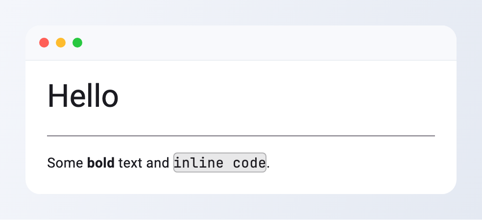

import { Tabs, TabItem } from '@astrojs/starlight/components'

## Install

<Tabs syncKey="install">
  <TabItem label="Command line">
    ```bash
    flutter pub add gpt_markdown
    ```
  </TabItem>
  <TabItem label="pubspec.yaml">
    ```yaml
    dependencies:
      gpt_markdown: ^1.4.1
    ```
  </TabItem>
</Tabs>

```dart
import 'package:gpt_markdown/gpt_markdown.dart';
```

One import brings in the widget, the style classes, the builder typedefs and
`GptMarkdownConfig`.

## Render something

```dart
GptMarkdown('# Hello\n\nSome **bold** text and `inline code`.')
```

That is the whole minimum. It renders like this:



:::note[Important]
The widget sizes itself to its content and does not scroll. For anything
longer than a sentence, put it in something scrollable — otherwise a long
reply overflows.
:::

```dart
SingleChildScrollView(
  padding: const EdgeInsets.all(16),
  child: GptMarkdown(reply),
)
```

In a chat list, one per bubble:

```dart
ListView.builder(
  itemCount: messages.length,
  itemBuilder: (context, i) => Padding(
    padding: const EdgeInsets.symmetric(vertical: 8),
    child: GptMarkdown(messages[i].text),
  ),
)
```

## Handling taps

Links do nothing on their own. The package does not depend on a URL launcher,
so opening one is your decision.

```dart
GptMarkdown(
  reply,
  onLinkTap: (url, title) => launchUrlString(url),
)
```

:::tip
LLM output can contain any URL. Validate before launching:
:::

```dart
onLinkTap: (url, title) {
  final uri = Uri.tryParse(url);
  if (uri == null) return;
  if (uri.scheme != 'https' && uri.scheme != 'mailto') return;
  launchUrl(uri);
},
```

The other callbacks follow the same shape:

```dart
GptMarkdown(
  reply,
  onImageTap: (url) => openLightbox(url),
  onCodeCopy: (code) => analytics.log('code_copied'),
  onSourceTagTap: (content) => showSource(content),
)
```

## Text style

The surrounding style comes from `style`; inline code size and list marker size
derive from it. Heading sizes do not: each level takes its style from
`GptMarkdownThemeData`'s `h1` to `h6`, which default to the Material text theme.

```dart
GptMarkdown(
  reply,
  style: Theme.of(context).textTheme.bodyMedium,
)
```

```dart
GptMarkdown(
  reply,
  style: const TextStyle(fontSize: 16, height: 1.5),  // roomier line spacing
)
```

:::tip
Set the body size **once**, here. Inline code and list bullets are sized as
factors of it rather than in absolute units, so they follow it.
:::

To restyle a component, see [customization](/docs/customization/).

## Right to left

```dart
GptMarkdown(reply, textDirection: TextDirection.rtl)
```

`textDirection` defaults to `TextDirection.ltr` and nothing reads the ambient
`Directionality`, so an RTL app passes it here. It governs block layout as well
as text — the document is wrapped in a `Directionality`, so lists, headings and
quotes take their leading edge from it even inside a page running the other
way. Fenced code keeps its LTR reading order and scroll origin.

Inline widgets — maths, images, links — are placed in the correct visual order
in mixed-direction paragraphs, which the framework does not do on its own
([flutter#54400](https://github.com/flutter/flutter/issues/54400)).

## Selection

Wrap it, the way you would any text:

```dart
SelectionArea(child: GptMarkdown(reply))
```

:::note
Copying across a block boundary currently yields the text run together, with
no separators. Every block — a paragraph, a list item, a table cell — is its
own text widget, and the framework concatenates what it selected from each
with nothing in between. Text inside one block copies as it reads.
:::

## Common mistakes

:::caution
**Rebuilding with a new builder closure on every frame.** Builders are not
compared when deciding whether to re-render, so a changed closure is ignored
until the widget remounts. Define them once, outside `build`, or key the
widget.
:::

:::caution
**Wrapping in `Expanded` without a scroll view.** The widget reports its
content height; constraining it without scrolling clips the reply.
:::

:::tip
**Rendering a reply while it generates?** Rebuild only the active message
with the complete text received so far. The renderer caches the segments that
have settled, so append cost stays roughly flat as the reply grows. See
[streaming and performance](/docs/streaming/#performance).
:::

## Next

* Make it look like your app → [customization](/docs/customization/)
* Render a reply as it generates → [streaming](/docs/streaming/)
* `@mention`, `#channel`, autolinks → [inline syntax](/docs/inline-syntax/)
* Look up every constructor option → [`GptMarkdown` options](/docs/options/)
