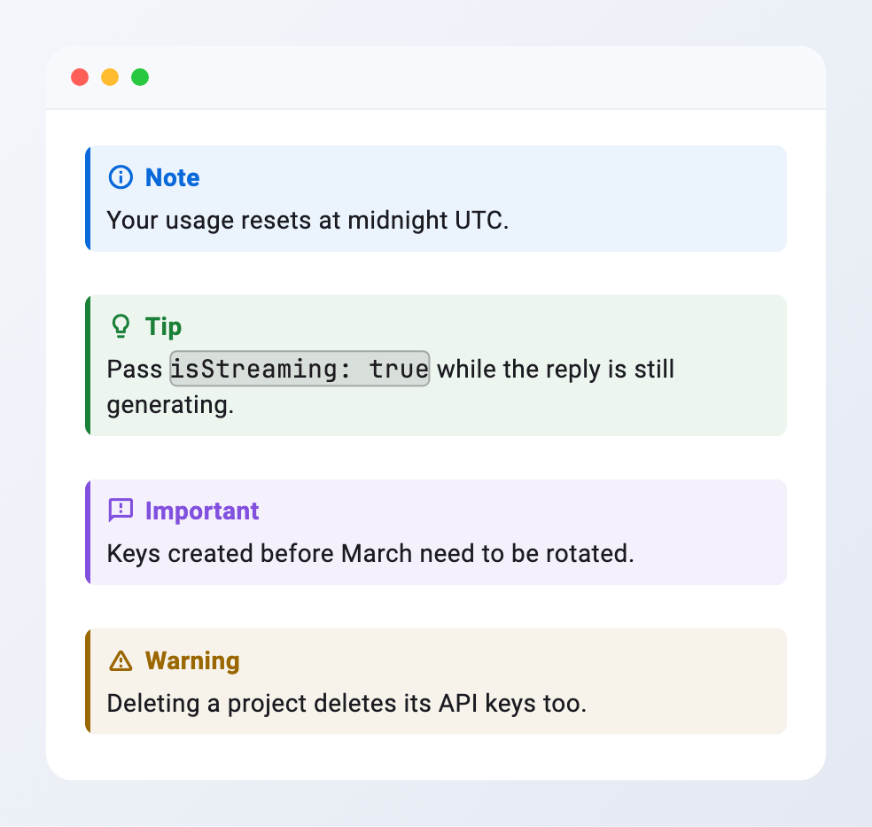
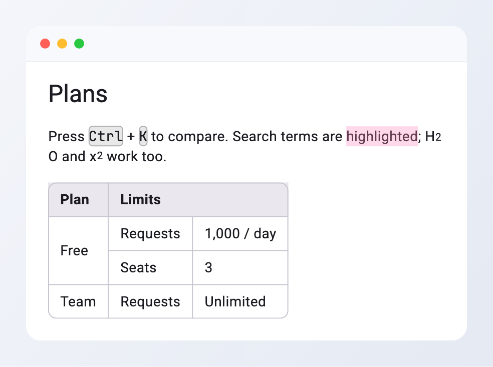

| | Syntax |
|---|---|
| Headings | `#` to `######` (closing `#`s optional), and `Title` underlined with `===` or `---` |
| Emphasis | `**bold**`, `*italic*`, `__bold__`, `_italic_`, `~~strike~~`, `<u>underline</u>` |
| Code | `` `inline` ``, ``` `` with ` inside `` ```, highlighted ```` ``` ```` and `~~~` fences |
| Lists | `-`, `1.`, nested |
| Tasks | `- [x]`, `- [ ]` |
| Options | `(x)`, `( )` |
| Tables | with `:---:` alignment |
| Quotes | `>` |
| Rules | `---` |
| Links | `[label](url "title")`, `[label](<url with spaces>)`, `[label][ref]` with `[ref]: url`, and bare URLs |
| Images | ``, `![alt][ref]`, and as a link: `[](url)` — PNG, JPEG, GIF, WebP and SVG |
| Maths | `\( inline \)`, `\[ block \]`, and `$…$` / `$$…$$` with `useDollarSignsForLatex` |
| Citations | `[1]` — with a `[1]: url` line, a tap opens the URL |
| Footnotes | `text[^1]` with `[^1]: note` |
| Alerts | `> [!NOTE]`, `[!TIP]`, `[!IMPORTANT]`, `[!WARNING]`, `[!CAUTION]` as a quote's first line — see [`AlertStyle`](/docs/components/alert/#styling) |
| Escapes | `\*`, `\_`, `\#`, `\$`, … show the character itself |
| Entities | `&amp;`, `&nbsp;`, `&#169;`, `&#x1F600;` |
| Comments | `<!-- hidden -->` |
| HTML | `<b>`, `<i>`, `<code>`, `<br>`, `<a href>`, ``, `<div>` wrappers — [the full list](/docs/commonmark/#html); add your own with [`htmlTags`](/docs/custom-components/#html-tags) |

Bare URLs, `www.` hosts, email addresses and `<https://…>` are linked
automatically — see [inline syntax](/docs/inline-syntax/).

## What it looks like

<div class="uv-shots">





</div>

Maths has [its own page](/docs/components/math/). Each image is one `GptMarkdown` widget,
rendered by the package's screenshot generator (`tool/screenshots/`).

## The rules that decide what stays text

The parser passes 530 of the 652 CommonMark 0.31.2 spec examples; the rest
are raw HTML and indented code blocks, which are not supported, and three
leniencies for model output. See [CommonMark conformance](/docs/commonmark/).

A few rules follow CommonMark and are worth knowing, because they decide
what stays plain text:

- An underscore inside a word is never emphasis: `snake_case_name` stays as
  written. Outside a word it is, so an unquoted `__init__` renders as bold
  `init` — put identifiers in backticks.
- `*` or `_` followed by a space opens nothing, so `2 * 3 * 4` is arithmetic.
- With `useDollarSignsForLatex`, maths comes first: a `$` pairs with the
  next `$` on its line, and the pair is maths unless both dollars are prices
  — `$5 and $10`, `$5M to $10M`, `5$ and 10$` stay prose. `$ x $`,
  `$2 + 3$` and `$1 \theta $2a` are maths. A `$` with no partner on its line
  is prose, and dollars inside code are never maths. Write `\$` for a dollar
  that must stay text, such as a price on the same line as a formula.
- `---` directly under a line of text makes that line a heading. Leave a
  blank line before `---` for a horizontal rule.
- Only a list starting at `1.` can begin inside a paragraph, so prose that
  wraps onto a line starting `14. ` stays prose. A line directly after a list
  item continues that item; leave a blank line to end the list.
- `**` is lenient — `**Note:**text` is bold — but a single `*` is not:
  `a*"b"*` stays as written.
- Footnotes render where their definitions are written, numbered in the
  order they are first referenced, as on GitHub. A definition nothing refers
  to is not shown.

## Code highlighting

Fenced code is highlighted automatically when it carries a language tag:

````markdown
```dart
final greeting = 'Hello';
```
````

Unknown or omitted languages remain readable as plain code. See
[code-block customization](/docs/components/code-block/#syntax-highlighting).

